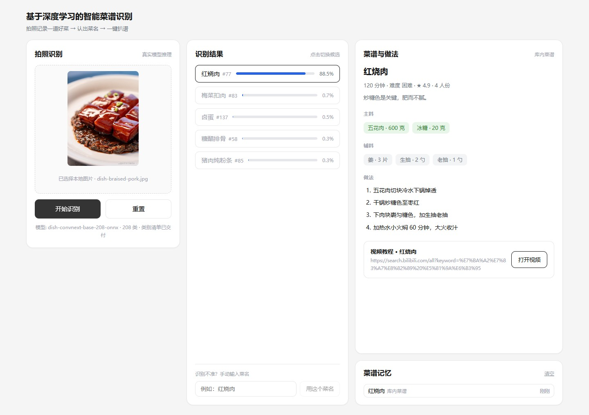
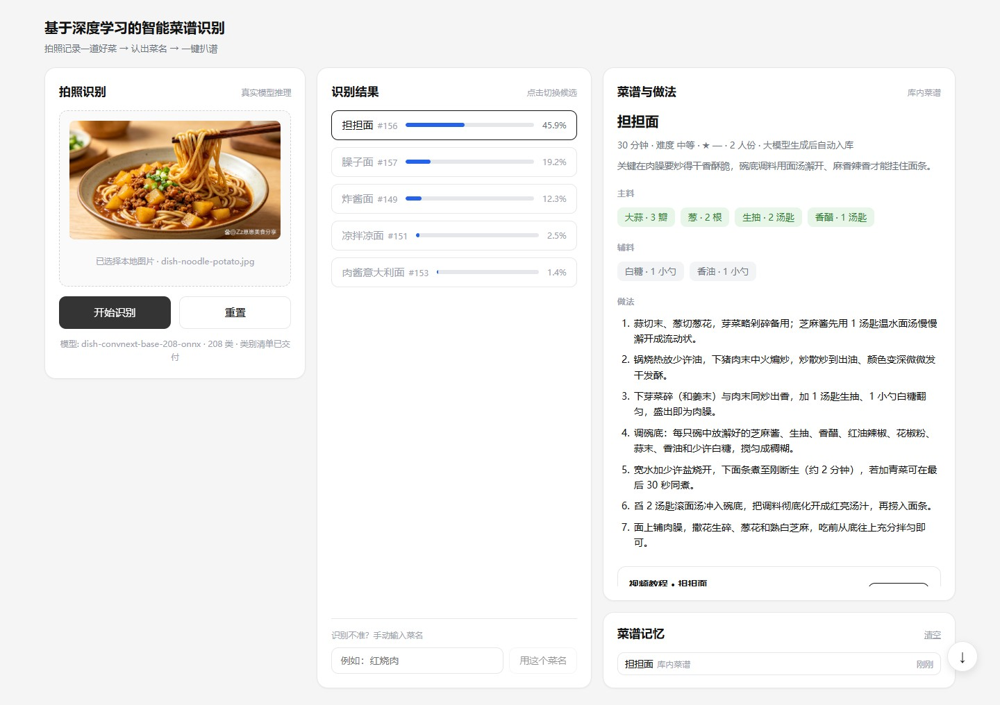
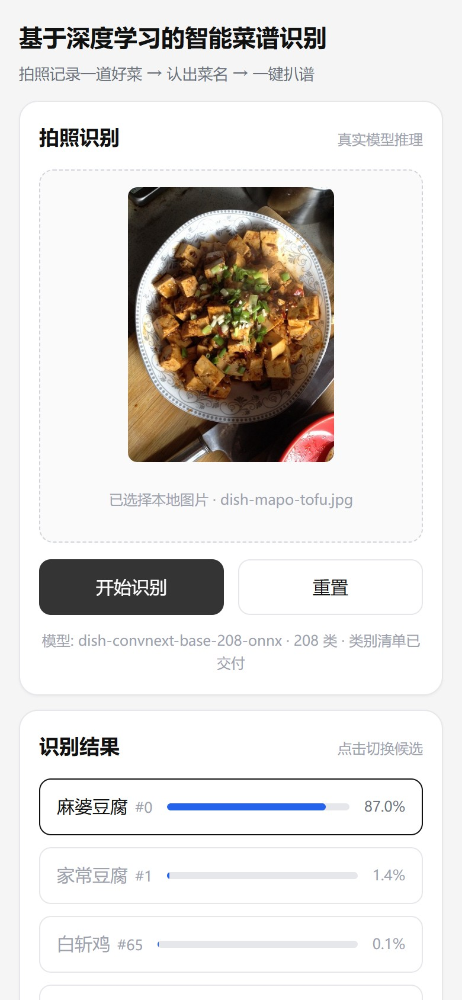
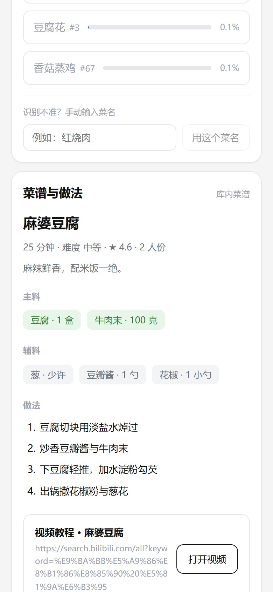

# 基于深度学习的智能菜谱识别

[](https://github.com/young-ty/smart-recipe/actions/workflows/ci.yml)

出门吃饭吃到一道好菜，想知道它叫什么、想以后在家也能自己做，往往卡在「不知道菜名就搜不到做法」。

这个产品的用法是**拍照记录 + 一键扒谱**：饭桌上随手拍一张，识别出是哪道菜，直接给出配比与步骤，并把它存起来。
菜谱库命中直接给，库外由大模型生成后落库，下次同一道菜直接命中；存下来的菜随时翻出来就能照着做。

识别模型为 **208 类菜品分类（timm `convnext_base.fb_in22k_ft_in1k`，288 × 288 输入）**，训练代码与前后端同在仓库里，
覆盖**前端 + 后端 + 模型接入层 + 菜谱内容**。详细设计见 `docs/项目设计方案.md`（v2.33）。

**在线演示**：<https://young-ty.github.io/smart-recipe/>。这是纯前端静态版，打开就能点示例图走完
「选图 → 候选 → 菜谱与做法 → 存进记忆」整条链路，手机上打开更像一个 App（可加到主屏）。
它没有后端：页面上的候选与置信度是 `models/dish.onnx` 的真实输出，菜谱是同一条链路真实返回后
固化的快照（库外那些由大模型生成后落库），全部固定文件、现场不跑模型也不联网。
发布方式见本文末「静态演示站」一节。

## 界面预览

<table>
<tr>
<td width="50%"><br>
<sub>桌面端三栏：左边选图，中间给 top-5 候选（红烧肉 <code>#77</code>，88.5%），右边直接是配比与做法 —— 这一张走的是库内命中</sub></td>
<td width="50%"><br>
<sub>库里没有的菜：拌面照被判成担担面（<code>#156</code>，置信度只有 45.9%，前三名咬得很紧），菜谱由大模型现场生成并写回库里，来源因此标着「生成后自动入库」</sub></td>
</tr>
<tr>
<td width="50%"><br>
<sub>手机端：同一套前端在窄屏退化成单栏，拍照识别与候选顺着排下来，可「添加到主屏」当 App 用</sub></td>
<td width="50%"><br>
<sub>手机端菜谱与做法：主辅料带用量，步骤拆到可执行粒度，库外菜同样标出来源</sub></td>
</tr>
</table>

> 四张截图都是本机跑真实模型拍的（`models/dish.onnx` + 本地后端），不是设计稿。
> 右栏底部的「菜谱记忆」把做过的菜存在本机，下次识别到同一道菜直接复用，不再请求大模型。

> **方向说明**：识别对象在 v2.0 由「生食材」调整为「成品菜」。
> 旧方向的产物（`prototype/index.html`、`backend/app/data/ingredient_mapping.json`）保留在仓库里作为历史留档，
> 但不再参与新链路；旧方向（FoodInsSeg 103 类食材分割）的权重与交付元数据已于 2026-09-26 清理，
> `models/` 只留成品菜这条线。取舍理由（需求分析 / 实现难度 / 公开数据集三个角度）见设计方案 1.5 节。

## 当前进度

| 项 | 状态 |
| --- | --- |
| 前端原型（三栏：拍图 / 候选 / 菜谱与做法） | 已完成，见 `prototype/dish.html`，数据由模型现场产出 |
| 前端应用（同一套三栏界面） | 已完成，见 `frontend/`，已按 v2.0 契约改造并与后端联调通过 |
| 模型转换与推理契约（`.pt` → ONNX、预处理落盘） | 已完成，见 `models/dish.manifest.json` |
| 设计文档、模型接入说明、生成式方案 | 已完成（v2.0 口径） |
| 后端接口（识别候选、菜谱检索与生成分流） | 已完成（v2.0）：`/api/recognize` 返回菜品候选，`/api/recipes/resolve` 先查库后生成，`/api/dishes` 暴露类别空间与承接情况 |
| 菜谱记忆（FR-15） | 已完成：做过的菜记在本机（`localStorage`）。**识别到做过的菜直接命中记忆、一个请求都不发**（库外菜不再重复消耗大模型额度）；也可以点记忆条目手动复用。入口在右栏菜谱面板下方 |
| 手机端 | 已完成：与网页同一套前端，窄屏退化成单栏，页头与右下角按钮避开状态栏与手势区，触摸目标不小于 48 px；配 `manifest` 与手写 service worker，可「添加到主屏」当 App 用 |
| 静态演示站（GitHub Pages） | 已完成：`npm run build:demo` 产出纯静态版并发布到 Pages，页面上的候选、置信度与菜谱都是真实模型与大模型输出固化成的快照，现场不跑模型、不联网。数据由 `backend/tools/export_demo_fixtures.py` 导出，契约见 `tests/test_demo_fixtures.py` |
| 类别清单（208 类菜名） | 已收到：`ONNX/Food list - Menu.csv` → `models/dish_labels.json`（`backend/tools/import_labels.py` 转换），页面名称一律用清单真名 |
| 生成结果落库 | 已完成：库外菜由大模型生成后写回 `recipes`（`origin = generated`，id ≥ 10000，评分为空），同名请求下次直接命中库内、不再消耗额度；页面标「大模型生成后自动入库」。`RECIPE_PROMOTE_GENERATED=0` 可关掉落库（演示每次都走生成分支）；老库启动时自动升到 schema v3 |
| 菜谱库覆盖率 | 208 类里 **73 类可承接**（64 类与类别名精确同名 + 9 类经 `alias` 别名映射）、**5 类显式缺口**（登记 `recipe_id: null`，走生成分支）、**130 类留白**（未登记）；库内 98 道菜谱。补库前先跑 `backend/tools/coverage_report.py`；种子文件的改动按条目同步进已有库，重启即生效。运行期生成结果落库后，`GET /api/dishes` 的可承接类别会随演示继续增加（自动入库的菜谱带 `origin = generated`，种子文件不被机器改写）；本报表只看种子文件，用来决定「该写哪些菜谱」 |
| 识别服务的并发与延迟 | 已完成：推理移出事件循环 + 并发闸门（默认 4，可配）。并发 8 的吞吐 6.31 → 9.80 req/s，突发期间 `/api/health` 由 1234 ms 回到 68 ms；压测入口 `backend/tools/concurrency_probe.py`，数据见 `docs/识别服务并发与延迟优化记录.md` |
| 可观测性 | 已完成：请求头 `X-Request-ID` 沿用或生成并写回、进 `ContextVar` 跟着日志走；日志默认「文本 + `[req=...]`」，`RECIPE_LOG_FORMAT=json` 可切 JSON；`GET /metrics` 暴露 11 项指标（自实现，不引第三方库）；离线读指标 `backend/tools/metrics_report.py`。见 `docs/可观测性与指标接入.md` |
| 推理硬件与启动预热 | 已完成：执行提供程序按可用性选择（`RECIPE_ONNX_PROVIDERS`，默认 `auto`）并**校验会话真正拿到了什么**，拿不到加速是 WARNING 并写进 `/api/health` 的 `model.providers`；启动预热把会话加载从第一个请求挪到启动阶段，首请求墙钟 1324 → 197 ms。GPU 已跑通：补齐 `nvidia-*` 运行库并在建会话前挂进 DLL 搜索路径（`backend/app/core/cuda_dlls.py`）之后，单张 p50 由 140.7 ms 降到 11.3 ms，见 `docs/模型接入说明.md` 第 10 节与 `docs/项目设计方案.md` 7.3.2 |

## 目录结构

```
backend/     FastAPI 服务：识别接入与降级、菜谱检索与生成分流、菜谱数据
frontend/    React + TypeScript 单页应用（Vite 构建）；public/ 放 PWA 图标、manifest 与 service worker，
             src/demo/ 是静态演示站的预置数据与取数逻辑
deploy/      容器化用的 nginx 配置（静态站点 + /api 反向代理）
prototype/   零依赖静态界面原型（视觉基准，双击即可打开）
demo/        演示用实拍图（页面从本地选图）；recipes.json 是静态演示站的菜谱快照
docs/        项目设计方案 / 模型接入说明 / 生成式推荐接入方案 / 测试报告 / 容器化部署 / 可观测性与指标接入
models/      训练产出的权重与元数据（权重不入版本库，元数据入库）
ONNX/        模型侧原始文件：208 类菜名清单 CSV 与权重调用注意事项
training/    模型训练代码与结果图：train.py / pilot.py、figures/、convnext-vs-resnet50d.html
tests/       仓库级文档与契约校验测试
.github/workflows/  CI（后端 + 契约 + 前端）与 GitHub Pages 演示站发布
Dockerfile.backend / Dockerfile.frontend / docker-compose.yml / .dockerignore
             容器化交付：一条命令拉起前后端，见 docs/容器化部署.md
```

## 演示怎么跑

```powershell
.\start-demo.bat          # 自检 → 起后端与前端 → 打开浏览器
.\start-demo.ps1 -Check   # 只自检，不启动
.\stop-demo.bat           # 收尾：一键停掉 8000 / 5173 上的服务
```

脚本先跑 `backend/tools/preflight.py`：Python 版本、后端依赖、权重与类别清单、种子数据、
数据库可写、大模型 Key、前端依赖、8000/5173 端口占用。有 FAIL 就直接停下不启动——
演示当天的问题最好在启动前暴露，而不是讲了一半才发现。**已经起着的服务会被跳过**
（只重开前端也能直接跑一遍），所以重复双击不会起两套；前端是等它真的能响应之后才打开浏览器，
不是固定等几秒。自检单跑：
`.\\.venv\\Scripts\\python.exe backend\\tools\\preflight.py`。

两个服务各开一个窗口，方便看日志，也可以在各窗口 Ctrl+C 收尾。

前端端口固定为 5173（`strictPort`：菜谱记忆存在 localStorage 里、按 origin 隔离，
端口一漂移记忆看起来就丢了），所以上一次没关干净时 Vite 会**直接报错而不是换端口**；
先跑 `.\stop-demo.bat` 清干净即可。只想看是谁占着端口、不动手，用 `.\stop-demo.ps1 -ListOnly`——
它只结束命令行里带本仓库路径的 python / node，别的程序只提示、不碰。

## 快速开始

### 1. 后端

```powershell
# 首次：创建虚拟环境并安装依赖
D:\Anaconda3\envs\py39\python.exe -m venv --system-site-packages .venv
.\.venv\Scripts\python.exe -m pip install -r backend/requirements.txt

# 可选：NVIDIA 显卡上要跑 GPU 推理时再装这份。缺了不会报错，只会静默回落 CPU
# .\.venv\Scripts\python.exe -m pip install -r backend/requirements-gpu.txt

# 启动（首次启动会自动建表并灌入 179 种食材 / 98 道菜谱）
cd backend
..\.venv\Scripts\python.exe -m uvicorn app.main:app --reload --port 8000
```

接口文档：<http://127.0.0.1:8000/docs>

> 后端已是 v2.0 口径的五条接口：`POST /api/recognize`（成品菜候选）、`POST /api/recipes/resolve`（先查库后生成）、
> `GET /api/recipes/{id}`、`GET /api/dishes`、`GET /api/health`。旧方向的 `/api/ingredients` 与 `/api/recommendations` 已下线（说明见设计方案 5.2 节）。
> 旧数据库首次启动会自动迁移 schema（SQLite `PRAGMA user_version` 1 → 2），只重建识别日志、生成缓存与类别承接表这三张可再生表，
> 菜谱与食材数据原样保留（迁移路径有 `backend/tests/test_database_migration.py` 守住）。

指标在 `GET /metrics`（Prometheus 文本格式，不在 OpenAPI 文档里）。不想起 Prometheus 就直接读成表：

```powershell
.\.venv\Scripts\python.exe backend\tools\metrics_report.py
```

### 2. 前端

```powershell
cd frontend
npm install
npm run dev          # http://127.0.0.1:5173
```

Vite 已把 `/api` 代理到 `http://127.0.0.1:8000`，前端代码只写相对路径。

页面是三栏：左侧拍照（选本地图片），中间 top-5 候选，右侧菜谱与做法；窗口不够宽时退化成左右两栏，
上传窗口始终留在左侧。演示用的成品菜实拍图在 `demo/dishes/`，从那里选图即可：
页面不再内置示例图入口，避免演示时误点内置图、看起来像「只有那几张能认」。

候选都不对（或一张候选都没识别出来）时，可以在候选区底部手动输入菜名继续查菜谱（FR-10）：
手输的名字不带类别下标，直接按菜名走后端「库内 → 别名 → 大模型生成并落库」的分流，识别错误不会把流程堵死。

右侧「菜谱与做法」下方是**菜谱记忆**（FR-15）：取到的每道菜都会记在本机，**识别到做过的菜时直接命中记忆**——
展示存下来的菜谱，一个请求都不发，库外菜也就不再重复调用大模型（省 token 的落点就在这里）；也可以点记忆条目手动复用。
记忆只落在本机 `localStorage`（键 `recipe-memory.v1`），不入库、不涉及用户数据外发，
坏掉也只是「下次看不到」，不影响识别与取菜谱。
演示请访问 `http://localhost:5173/`。

手机上也能开同一套界面（`npm run dev` 会把 Network 地址一起打出来，形如
`http://192.168.x.x:5173`，手机连同一个网络直接访问即可）：窄屏下三栏自动叠成单栏，
页头避开状态栏、右下角按钮避开手势区，候选与记忆条目的触摸目标不小于 48 px。
想把它当 App 装到主屏，需要页面跑在 HTTPS 下（`localhost` 除外），局域网 http 地址装不上；
手机访问真后端时记得让 `VITE_API_BASE_URL` 指向电脑的局域网 IP，`localhost` 在手机上指的是手机自己。

### 3. 界面原型（不用装依赖）

```powershell
prototype\index.html     # 旧方向（食材识别）原型，仅作视觉基准保留
prototype\dish.html      # 成品菜识别方向的演示（当前方向）
```

`prototype/dish.html` 是自包含的静态页，双击就能打开：左边选示例图 → 中间看 top-5 候选 →
右边看菜谱与做法。页面里的候选和置信度是现场跑 `models/dish.onnx` 算出来的，不是手抄的；
换了权重或改了菜谱库，重跑生成器即可刷新，测试会拦住对不上的页面：

```powershell
.\.venv\Scripts\python.exe -m prototype.build_dish_prototype
.\.venv\Scripts\python.exe -m unittest tests.test_dish_prototype -v
```

演示图放在 `demo/dishes/`，页面用相对路径引用，断网也能显示。

### 4. 查菜谱库覆盖率

「覆盖率」有三种不同的分母，混着看会得出错误结论，所以单独给了一个只读报表：

```powershell
cd backend
..\.venv\Scripts\python.exe -m tools.coverage_report         # 人读报表
..\.venv\Scripts\python.exe -m tools.coverage_report --json  # 给脚本消费
```

它会分**可承接**（有菜谱）/ **显式缺口**（登记为无菜谱，走生成分支）/ **留白**（压根没登记）三组，
并单独列出两件容易漏的事：**闲置菜谱**（写了但没有任何类别指向它）与**别名候选**
（西红柿/番茄、茸/蓉 这类同义或错字，确认是同一道菜后加一行映射即可补上，不用新写菜谱）。
报表只读，不改任何数据文件。

### 5. 补菜谱库（起草 → 审校 → 合并）

留白类别要补菜谱时，用起草脚本把「写一道菜谱」变成「审一道菜谱」：

```powershell
cd backend
..\.venv\Scripts\python.exe -m tools.draft_recipes                     # 只列出这次会处理哪些类别（不联网）
..\.venv\Scripts\python.exe -m tools.draft_recipes --write --limit 10  # 真实调用生成层，写草案
..\.venv\Scripts\python.exe -m tools.draft_recipes --merge             # 合并审校过的草案
```

草案落在 `drafts/recipe_drafts.json`（已 gitignore，是中间产物）。**中间那一步必须是人**：改菜名、步骤、用量，
补 `rating`（生成层按设计不给评分），把 `approved` 改成 `true`。`--merge` 只收 approved 且字段齐全的条目——
未经审校、缺评分、食材没映射到 id 的一律拒绝并说明原因，不做部分合并。
食材匹配走 `seed_ingredients.json` 的名字与别名（西红柿/蕃茄、蒜/蒜瓣 都认），匹配不上记进
`unmatched_ingredients` 交人工决定。合并后跑一遍 `pytest backend/tests -q`，契约测试会检查新条目与清单口径是否一致。

### 6. 跑测试

```powershell
.\.venv\Scripts\python.exe -m pytest     # 仓库级文档契约测试 + 后端接口测试
python -m unittest discover -s tests -t .  # 仅文档契约测试（无需第三方依赖）
node tests\prototype_smoke.js            # 旧原型无浏览器冒烟测试

cd frontend; npm test                    # 前端组件与页面测试
```

### 7. 覆盖率与压测（NFR-01 / NFR-06）

验收要的两个数字在这里取；口径固定，别人复跑应得到同级结果：

```powershell
.\.venv\Scripts\python.exe -m pytest --cov   # 后端覆盖率，口径见 .coveragerc
cd frontend; npm run test:coverage           # 前端覆盖率（v8）

# NFR-01 压测：默认 100 次识别 + 100 次菜谱检索，用临时库，不动开发库
.\.venv\Scripts\python.exe backend\tools\perf_probe.py
.\.venv\Scripts\python.exe backend\tools\perf_probe.py --strict --json-out .codex-build\perf-probe.json
```

压测走进程内 TestClient（不经网络与 uvicorn），热身两轮再计时，并把大模型 Key 显式置空——
库外菜走生成会把网络时延混进 P95，而生成接口另有独立预算（实测 3~7 秒返回，单次超时上限 20 秒）。
结果与结论见 `docs/测试报告.md`。

### 8. 容器化启动（可选）

本机跑法要装 Python、Node、依赖和权重；对方机器上只装 Docker 的话走这条路：

```powershell
docker compose up -d --build   # 构建并启动，入口仍是 http://localhost:5173/
docker compose ps              # 看状态
docker compose logs -f backend # 跟踪后端日志
docker compose down            # 停止（数据库留在名为 recipe-data 的卷里）
```

权重要求放在宿主机的 `models/` 下，以只读方式挂进容器，换模型不用重新构建；
大模型 Key 从仓库根的 `.env` 注入，没有它也能起来，只是库外菜会提示生成不可用。
国内网络下首次构建要看的坑（基础镜像、pip / npm 源、代理注入）都记在
`docs/容器化部署.md`，连同冷启动与压测的实测数字。

### 9. 静态演示站（GitHub Pages）

给简历 / 面试留一个点开就能看的链接。这一版是纯前端：335 MB 的 ONNX 跑不动，没有后端也就没有
大模型 Key，所以它不假装自己在推理，而是把**真跑过一次**的结果固化下来——
候选与置信度来自现场跑 `models/dish.onnx`，菜谱走同一条链路真实返回后再导出，全部写进
`frontend/src/demo/fixtures.json`。演示模式只在构建时打开，开发和联调走的仍是真后端。

```powershell
cd frontend
npm run build:demo    # 类型检查 + vite build --mode demo
npm run preview       # http://localhost:4173/ 本地看一遍
```

`--mode demo` 除了切数据源，还会把 `demo/dishes/` 的实拍图复制进产物并补一个 `.nojekyll`
（Pages 默认拿 Jekyll 过一遍，下划线开头的文件会被丢掉）。示例图的真身仍在 `demo/dishes/`，
只复制、不再存一份到 `frontend/public/`，免得同一个文件两处维护。

发布由 `.github/workflows/deploy-pages.yml` 负责：推送到主分支后自动构建并部署。
仓库里第一次用要先在 `Settings → Pages → Build and deployment` 把来源选成 **GitHub Actions**，
本站已上线：<https://young-ty.github.io/smart-recipe/>。换了仓库名的话，把地址里的用户名与仓库名换掉即可。
路径过滤只认 `frontend/**`、`demo/dishes/**` 与工作流自身，纯文档改动不会触发构建，
需要时到 Actions 里手动 Run workflow。

改了这一版的内容要重跑导出脚本，否则页面上的数字就是编的（`tests/test_demo_fixtures.py` 会拦住）：

```powershell
.\.venv\Scripts\python.exe -m backend.tools.export_demo_fixtures
```

## 大模型 API 接入（生成层）

库内菜谱直接返回，**库外菜的做法由大模型生成并写回库内**（方案见 `docs/生成式推荐接入方案.md`）。这一步是可选配置：
不配 Key 系统照常运行，库外菜返回 `source="unavailable"`、`degraded=true`，页面提示「菜谱库暂缺，生成服务不可用」
——能力可以没有，接口契约不能变。

**配置**：把 `.env.example` 复制成 `.env`，填下面几个变量（`.env` 与 `.env.local` 都在 `.gitignore` 里，不入库）：

```ini
RECIPE_GENERATOR_API_KEY=sk-...                        # 必填，DeepSeek 控制台申请
RECIPE_GENERATOR_BASE_URL=https://api.deepseek.com/v1
RECIPE_GENERATOR_MODEL=deepseek-flash
RECIPE_GENERATOR_TIMEOUT_SECONDS=20                     # 可选，默认 20 秒：单次生成的超时上限
RECIPE_PROMOTE_GENERATED=1                              # 可选，默认 1：生成结果落库；设 0 则只写缓存
```

**生成结果落库**：生成成功的菜谱写回 `recipes`（`origin = generated`、id 从 10000 起编、评分为空），
主辅料（已由闸门保证能挂上食材表）与步骤一并入库，同名请求下次直接命中库内、不再消耗额度；如果这次请求带了类别下标、且该类别在
`dish_recipe_map` 里正是显式留白，落库时顺带认领它。落库失败只记日志，本次回答仍用生成结果。
要演示「每次都走生成分支」，把 `RECIPE_PROMOTE_GENERATED=0` 写进 `.env` 即可。

系统环境变量优先于 `.env`（`.env` 只补空缺），部署时不必改文件。换供应商只改 `BASE_URL` 与 `MODEL`：
调用走 OpenAI 兼容的 `POST /chat/completions`，声明 `response_format={"type":"json_object"}`，
返回内容经 Pydantic 校验（菜名 / 时长 / 难度 / 份量 / 主辅料 / 步骤齐备），
步骤还卡一道质量线（3~15 条、其中至少 3 条不少于 6 字），任一条不合格即整体降级且不写缓存。
过了结构校验还要过**当次闸门**：菜名必须就是请求的那道菜（答非所问直接降级），主辅料必须能挂到食材字典上
（挂不上的从当次结果里剔除，主料全挂不上则降级）。闸门排在写缓存与落库之前，所以当次看到的菜谱
和入库后查到的是同一份。

提示词拆成两条消息：system 放角色与输出契约，user 只放菜名（书名号定界，进提示词前先去掉控制符与零宽字符），
手输的菜名因此带不动提示词。解析前先按括号配对截出 JSON 对象，兼容实现把结果包进 ```json 围栏或加句寒暄
也不会被误判成失败；输出里出现 `http` 直接判本次失败（视频入口只由后端拼接）。请求带 `max_tokens = 4096`：
这个模型把 reasoning token 也算进这个上限，给小了正文会被截成半截 JSON（实测 cap=200 时正文为空、
cap=600 时只剩 37 字）。连接阶段失败（`ConnectError` / `ConnectTimeout`）重试一次，读超时不重试。
实测记录见 `docs/生成式推荐接入方案.md` 第 13 节。

**自检**：生成分支的失败一律降级成 `unavailable`，页面上看不出「没配 Key」和「这次超时了」的区别，
所以单独给了一个脚本（默认模式不发网络请求，可进 CI）：

```powershell
cd backend
..\.venv\Scripts\python.exe -m tools.check_generator            # 只看配置，确认 Key 被读到
..\.venv\Scripts\python.exe -m tools.check_generator --models   # 列出这把 Key 能用的模型 id
..\.venv\Scripts\python.exe -m tools.check_generator --live     # 真实生成一道库外菜并校验结构
```

脚本与 `GET /api/health` 的 `generator` 字段都只回显 Key 的长度与前缀，不回显 Key 本身。
运行期自检：`GET /api/health` → `"generator": {"configured": true, "model": "deepseek-flash"}`。

真实调用的验收用例默认**整文件跳过**（`backend/tests/test_generator_live.py`：确认模型 id 在服务端列表里、
生成结果通过结构校验、`/api/recipes/resolve` 对库外菜返回 `source="generated"` 且落缓存），显式打开开关才联网：

```powershell
$env:RECIPE_LIVE_TESTS="1"
.\.venv\Scripts\python.exe -m pytest backend/tests/test_generator_live.py -v
```
**实测（2026-09-22）**：`--models` 返回 `deepseek-flash`、`deepseek-v4-pro`；`--live` 生成「蛋包饭」通过结构化校验
（主料 5 项 / 步骤 6 步，约 5 s）。复现命令见上。

## 模型接入

模型权重不入版本库（单份 335 MB），挂在本仓库的 Release 上：从 Releases 页下载 `dish.onnx`
放进 `models/` 即可，校验和以 `models/dish.manifest.json` 里记的为准。类别清单与推理契约
（`dish_labels.json`、`dish.manifest.json`）随仓库分发，权重没到位时后端自动降级为模拟识别，
接口契约不变。

**当前权重：成品菜分类（v2.0 方向）**

| 项 | 取值 |
| --- | --- |
| 原始交付 | `ONNX/best.onnx`（timm `convnext_base.fb_in22k_ft_in1k`，208 类，288 输入，训练直接产出 ONNX，351,270,213 字节） |
| 运行时产物 | `models/dish.onnx`（与交付件同一份字节，输入 `[N,3,288,288]`，输出 `[N,208]`；交付目录里的原始 ONNX 与 zip 已在归档校验通过后清理） |
| 推理契约 | `models/dish.manifest.json`：来源校验和、架构、类别数、预处理（bilinear、crop_pct 0.875、短边缩放到 329、ImageNet 归一化） |
| 正式类别清单 | 已收到：`ONNX/Food list - Menu.csv`（208 行，训练产出）→ 经 `backend/tools/import_labels.py` 校验转为 `models/dish_labels.json`（类别下标 → 菜名，顺序与训练一致） |
| 演示图注 | `backend/app/data/dish_captions.json`：只覆盖 4 张演示图，已与交付清单对齐真名；仅在清单缺失时作为退路并标「待确认」 |
| 实测耗时 | CPU 单张前向约 143 ms（第一代 resnet50d 是 18 ms，仍远低于 NFR-01 的 500 ms 预算） |
| 第一代留档 | `best.pt`（274.5 MB，224 输入、双三次插值，`best_top1 = 0.7923`）与 `models/dish-resnet50d-208.onnx`；换用依据见 `docs/模型接入说明.md` 2.1 |

预处理实现固化在 `prototype/preprocess.py`，页面生成与校验共用同一份代码——缩放用 `int()` 截断、
中心裁剪起点用 `round()`，这两处差一个像素就会让置信度明显漂移。

**旧权重：食材分割（v1.3，已退役）**

旧方向（FoodInsSeg 103 类生食材）的 Ultralytics YOLOv8s-seg 权重与其元数据
（`best.onnx`、`labels.json`、`preprocess.json`、`model_manifest.json`）已在 2026-09-26 清理，
`models/` 现在只保留成品菜这条线的两个权重：在用的 `dish.onnx`（ConvNeXt-Base）与第一代留档
`best.pt` / `dish-resnet50d-208.onnx`（ResNet-50d）。旧方向的训练输出不再随仓库分发，
`training/` 现在只留成品菜这条线的代码与结果图。

**只有 `.pt` 时怎么转 ONNX**

先判定它是哪一种存档（state_dict / 整模型 / 训练 checkpoint / TorchScript），再决定是重新导出还是自行转换：

```powershell
# 只看格式，不反序列化，不会执行文件里的代码
.\.venv\Scripts\python.exe backend\tools\inspect_checkpoint.py models\dish.pt

# 确认能还原后再导出 ONNX；类别数会从 fc 层自动推断
.\.venv\Scripts\python.exe backend\tools\inspect_checkpoint.py models\dish.pt `
    --export-onnx models\dish.onnx --timm convnext_base.fb_in22k_ft_in1k
```

架构名取判定输出里的「权重里出现的架构名」。**timm 架构必须用 `--timm`**：torchvision 也有
`resnet50`，但缺 deep stem 与 avg_down，键对不上、加载必失败；torchvision 原生架构才用 `--arch`。
导出会在 ONNX 旁边写一份 `dish.manifest.json`，记录来源校验和、类别数与预处理契约。

torch / timm 只在这一步用到，见 `backend/requirements-tools.txt`，**不进后端运行时**。

后端启动时自动加载；**权重缺失、加载失败或推理异常都会自动降级为模拟实现**，接口契约不变，
响应中 `degraded: true`，前端页脚显示「当前为模拟结果」。

## 说明

- 数据来源为 `backend/app/data/*.json`，与代码同版本管理；入库幂等，重复启动不会重复插入。
- API Key 轮换：Key 只写在 `.env`（已 gitignore），不要贴进文档、截图或提交信息；一旦外泄就在控制台重置。
- 隐私约束：不落盘保存用户上传的原图，`recognition_logs` 只记录图片摘要与识别结果；
  调用大模型时只发送菜名，不发送照片。
- 提交规范：每次改动都需附带测试并形成一次 commit（见 `AGENTS.md`）。

## 许可

代码以 [MIT](LICENSE) 授权。
